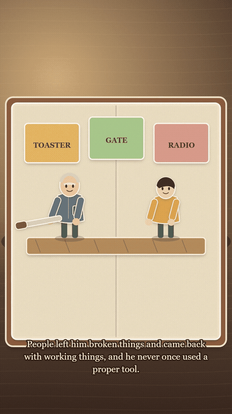

# AI Content Creator

[](https://github.com/ashiqurrahmananik/ai-content-creator-skill/stargazers)
[](LICENSE)
[](README.md)
[](README.md)

**From viral Shorts research to a finished vertical video — as a skill for both OpenCode and Claude Code.**



This skill researches YouTube Shorts, Facebook/Instagram Reels, TikTok and animation/explainer charts with an **animation-first filter** (photorealistic AI-human clips are excluded), returns ten ranked topics with **direct YouTube Shorts links**, writes an original tagged script, generates or intakes the voiceover, and hands a prepared project to a film engine. It never copies a viral video's characters, shots, captions, sounds or edits.

Repository: https://github.com/ashiqurrahmananik/ai-content-creator-skill

## Why this exists

Most "AI video" prompts stop at a script. This one carries the whole baton:

| Stage | What you get |
|---|---|
| Research | Ten scored topics with dated sources and direct `youtube.com/shorts/<ID>` links; animation/explainer-first mix check filters out AI-human clips |
| Script | Three files: clean text, ElevenLabs `[ ]` tags, and `[[[ ]]]` director notes |
| Voice | User recording, or auto TTS — ElevenLabs when a key exists, otherwise free offline Kokoro |
| Dialogue | Narrator voice plus mapped character voices for quoted speech |
| Handoff | A prepared project for `lemo-opuscar` or `cartoon-audio-short`, including contact-sheet approval |

## Quickstart

### OpenCode

```powershell
$src = "C:\path\to\ai-content-creator-skill\opencode"
$dst = "$env:USERPROFILE\.config\opencode"
Copy-Item -Recurse -Force "$src\skills\ai-content-creator" "$dst\skills\"
Copy-Item -Force "$src\agents\ai-content-creator.md" "$dst\agents\"
Copy-Item -Force "$src\commands\ai-content-creator.md" "$dst\commands\"
```

macOS / Linux:

```sh
cp -R opencode/skills/ai-content-creator ~/.config/opencode/skills/
cp opencode/agents/ai-content-creator.md ~/.config/opencode/agents/
cp opencode/commands/ai-content-creator.md ~/.config/opencode/commands/
```

Restart OpenCode, then type `/ai-content-creator`.

### Claude Code

```powershell
Copy-Item -Recurse -Force "C:\path\to\ai-content-creator-skill\claude\skills\ai-content-creator" "$env:USERPROFILE\.claude\skills\ai-content-creator"
```

macOS / Linux:

```sh
cp -R claude/skills/ai-content-creator ~/.claude/skills/ai-content-creator
```

Restart Claude Code, then type `/ai-content-creator`. Optionally copy `claude/CLAUDE.md` into your project root for a compact always-on summary.

## Requirements

- Python 3.11+ and `ffmpeg` / `ffprobe` on `PATH`.
- OpenCode or Claude Code.
- A film-engine skill for the final render: `lemo-opuscar` and/or `cartoon-audio-short`. They are **not** bundled here.
- For TTS: set `ELEVENLABS_API_KEY` for ElevenLabs, or install lemo-opuscar's free Kokoro voice tier (`setup.sh deps voice`, about 0.55 GB). Without a key, the skill falls back to Kokoro automatically.
- Web research uses the host's tools: `websearch`/`webfetch` in OpenCode, `WebSearch`/`WebFetch` in Claude Code.

The API key is read from the environment only. It is never written into a script, brief, report or project file.

## What makes this different

- **Evidence-first research:** every number is sourced and dated; tracker-derived links are labelled; no invented view counts or video IDs.
- **Direct links only:** every topic links to `youtube.com/shorts/<ID>`, never a tracker or roundup page.
- **Scope control:** choose `Cartoon-ready` or `All videos`; reply `cartoon` or `all` for a new dated report.
- **Production-grade script discipline:** spoken words, emotion tags and director notes live in separate files so TTS never speaks a stage direction.
- **Consent-gated audio:** a short voice preview is approved before the full generation, so ElevenLabs credits are not spent blindly.
- **Voice integrity:** a user-supplied recording is never re-timed, ducked, pitched or compressed. Music/SFX sit at 50% of the voice level.
- **Engine-agnostic handoff:** the audio and script work with either cartoon or lemo; the engine is chosen by need, not by who made the audio.

## Repo layout

```text
opencode/                       OpenCode skill, agent and slash command
claude/                         Rebuilt Claude Code skill + CLAUDE.md
examples/grandparent-clock-lesson/
                                Brief, three script versions, cast map, treatment
docs/demo.gif                   10-second preview of a real finished film
PUBLISH.md                      GitHub publish instructions
CONTRIBUTING.md                 How to contribute
ROADMAP.md                      Planned work
LAUNCH.md                       Ready-to-post launch copy
```

## Safety rules

- Original characters only: no real named living people, brand mascots, logos, politics or graphic content.
- No copied shots, captions, sounds or edits from trending videos.
- No captions unless the user asks or approves a contact sheet that shows them.
- Work happens under `~/shorts/<slug>`, never inside the user's current project repo.
- A contact-sheet approval gate comes before any final render.

## Contributing and roadmap

See [CONTRIBUTING.md](CONTRIBUTING.md) and [ROADMAP.md](ROADMAP.md). Issues marked `good first issue` are a good place to start.

If this project saved you time, a star helps other people find it.

## License

MIT — see [LICENSE](LICENSE).
