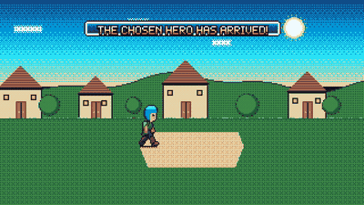

# Example: The Stick of Destiny

*Autoplay preview — 8 seconds, 8 fps. Full film: [`the-stick-of-destiny.mp4`](the-stick-of-destiny.mp4).*

A finished example film included as a showcase binary. It is force-added with `git add -f` because the repository `.gitignore` excludes `*.mp4`.

| Item | Value |
|---|---|
| Video | `the-stick-of-destiny.mp4` |
| Duration | 50.00 s |
| Frame size | 1920 × 1080 (landscape) |
| Frame rate | 24 fps |
| Video / audio codec | H.264 / AAC |
| File size | 11,168,255 bytes (~10.6 MiB) |

This is an output-side example: a rendered MP4, not a worked input example. For the input-side example (brief, three script versions, voice map and treatment), see [`../grandparent-clock-lesson/`](../grandparent-clock-lesson/).
